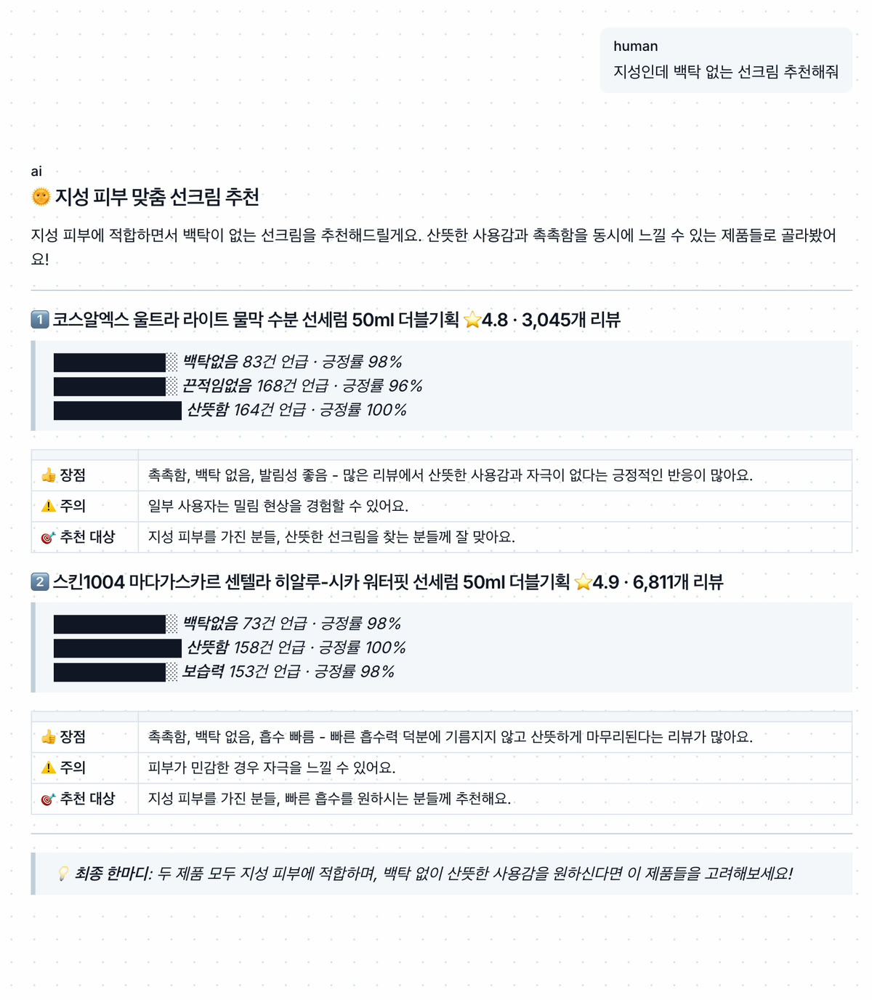
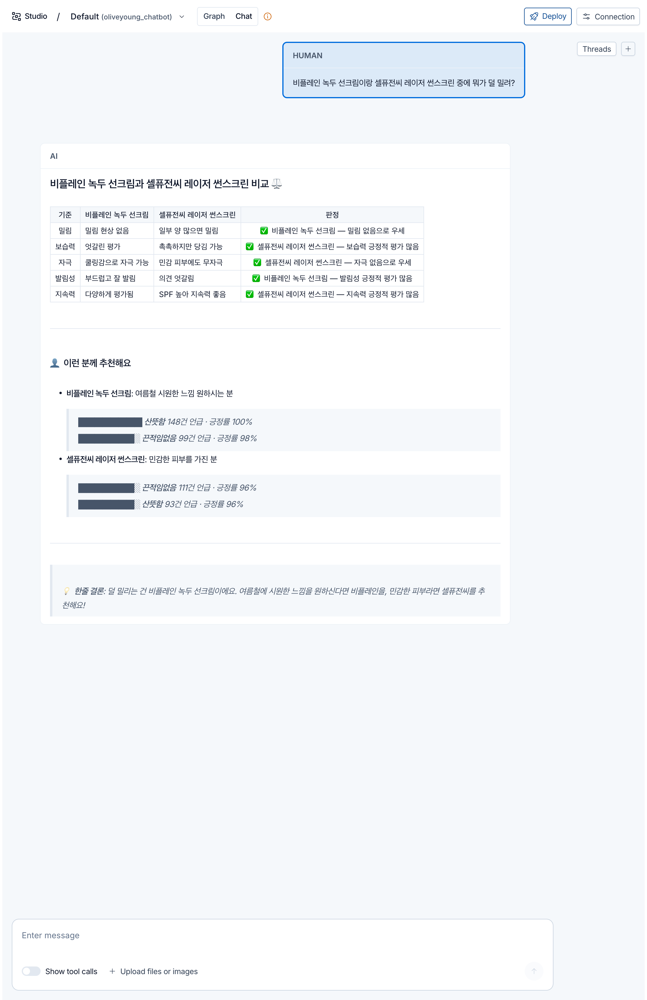
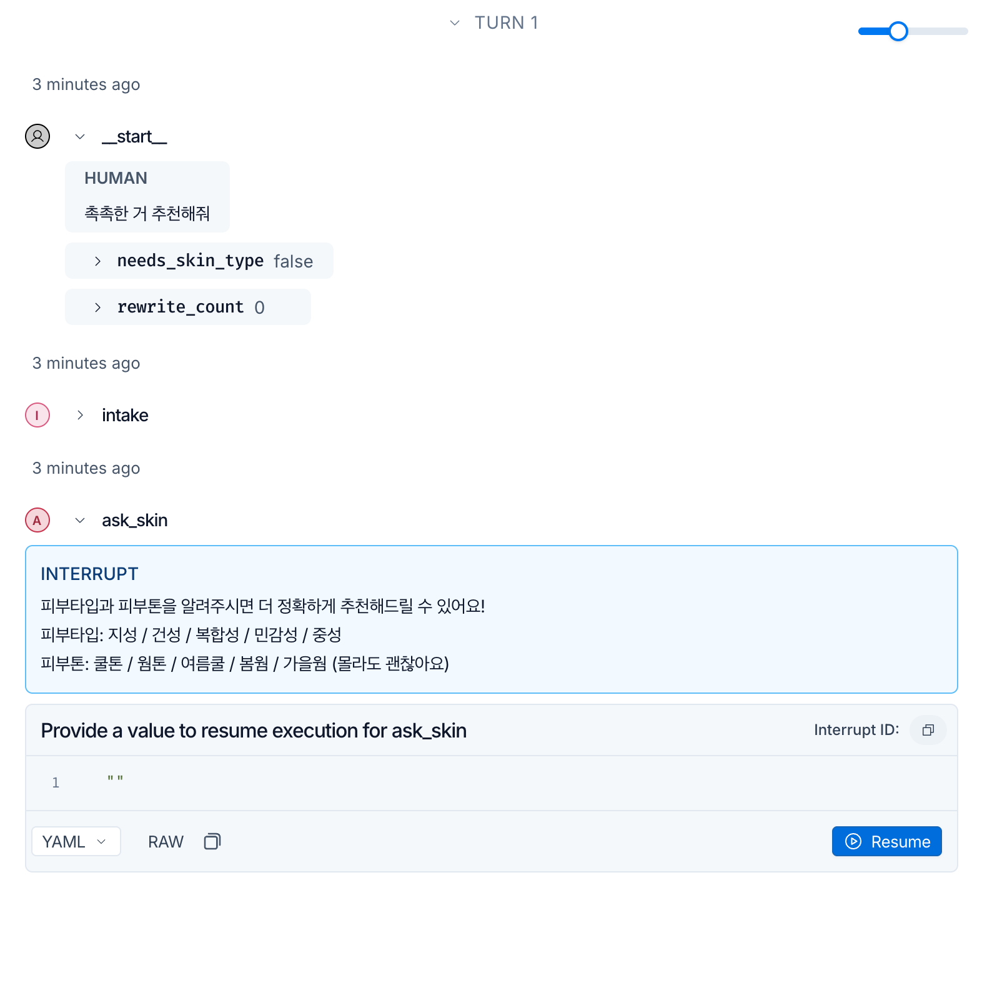
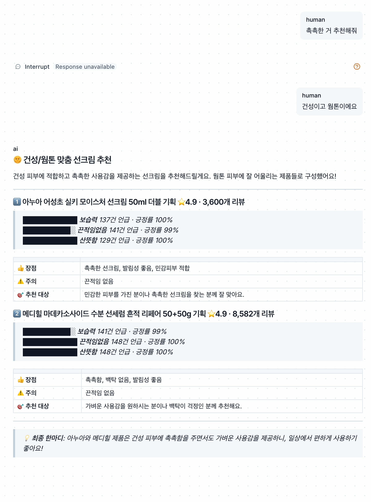

# 올리브영 선크림 리뷰 RAG 챗봇

> 리뷰 약 6,000건(5,999건)을 근거로 선크림을 **추천·비교·필터링**하고, 답변마다 **근거 리뷰를 함께 보여주는** LangGraph 기반 챗봇입니다.
> "리뷰가 많다"가 아니라 "내 피부타입에서 백탁·밀림 없다는 리뷰가 몇 건인지"로 답하도록 설계했습니다.

---

## 왜 만들었나

선크림 리뷰는 수천 건이지만 실제로 궁금한 건 하나입니다. **"나 같은 피부에 이거 괜찮아?"**
범용 LLM은 그럴듯하게 답하지만 근거가 없고, 단순 검색은 리뷰를 읽어주지 않습니다.
그래서 세 가지를 원칙으로 잡았습니다.

1. **근거 없이 답하지 않는다** — 검색된 리뷰가 부족하면 되묻거나, 질문을 재작성하거나, 마지막에만 "리뷰 근거 없음"을 명시하고 일반 답변
2. **규칙으로 할 수 있는 건 LLM에 맡기지 않는다** — 라우팅·충분성 판정·가중치 계산은 전부 순수 함수 (LLM 호출 없음)
3. **피부타입은 가정하지 않는다** — 질문에 피부타입이 없고 필요하면 `interrupt`로 사용자에게 묻는다

---

## 데모

### 추천 — "지성인데 백탁 없는 선크림 추천해줘"

백탁없음 긍정률 상위 제품을 고르고, 제품마다 속성별 언급 수·긍정률과 리뷰 근거를 함께 보여줍니다.



### 비교 — "비플레인 녹두랑 셀퓨전씨 레이저 중에 뭐가 덜 밀려?"

질문이 물은 기준(밀림)을 표 첫 행과 결론 첫마디에 둡니다. 기준별 승자와 표의 숫자는 **코드가 DB 긍정률로** 정합니다(차이 5%p 미만은 무승부).



### 되묻기 (interrupt) — "촉촉한 거 추천해줘"

피부타입이 없으면 `ask_skin`에서 그래프를 멈추고 사용자에게 묻습니다. LangGraph Studio에서는 되묻기 칸에 답을 넣고 **Resume**을 눌러야 멈춘 곳부터 이어집니다(채팅창으로 답하면 새 질문으로 처음부터 실행됩니다).



<details>
<summary>"건성이고 웜톤이에요"로 답하면 원래 질문으로 이어서 추천</summary>



</details>

---

## 아키텍처

```
START
  │
  ▼
intake ──(LLM, structured output: query_type · 제품 · 피부타입 · 피부톤 · 속성)
  │
  ├─ 피부타입 필요한데 없음 ──► ask_skin ──(interrupt)──► 원래 분기로 복귀
  ├─ 추천 / refine ──────────► rec_sub   (추천 서브그래프)
  ├─ 비교 ─────────┬─ 제품 1개 ► ask_compare ──(interrupt)
  │                └─ 2개 이상 ► cmp_sub   (비교 서브그래프)
  └─ 필터해석 ─────────────► fil_sub   (조건 필터 서브그래프)
                                   │
                              validate_router  ◄── 순수 로직, LLM 없음
                                   │
          ┌────────────────────────┼─────────────────────┐
     충분함                 부족 (rewrite < 3)        부족 (rewrite ≥ 3)
          │                        │                      │
     review_ins               rewrite ──► intake      fallback
   (근거 리뷰 요약)                                  (근거 없음 명시)
          │
      generate ──► END
```

**충분성 기준** (`graph/routers.py :: validate_router`)

| query_type | 충분 조건 | 이유 |
|---|---|---|
| 추천 / refine | 검색 리뷰 ≥ 3 | 1~2건으로 추천하면 과잉 일반화 |
| 필터해석 | 검색 리뷰 ≥ 3 | 피부타입·톤 조건 리뷰는 더 엄격하게 |
| 비교 | 제품별 요약 존재 | 서브그래프에서 요약·DB 판정까지 완료 → review_ins 생략 |
| follow_up | 검색 리뷰 ≥ 1 | 이전 맥락이 있어 적은 수로도 답변 가능 |

---

## 데이터 파이프라인

```
crawling.py ──► oliveyoung_sunscreen_reviews.json   (선크림 30종 × 최대 250건 수집 → 중복 제거 후 5,999건)
      │
analyze_aspects.py ──(LLM 분류)──► review_aspects.json      리뷰별 8개 속성 positive/negative/none
                                 ► product_stats.json       제품별 속성 집계
                                 ► skin_type_weights.json   피부타입별 속성 가중치
      │
migrate_to_pg.py ──► PostgreSQL + pgvector
      │                products · reviews(+embedding) · product_stats · skin_type_weights
add_aspect_columns.py ──► reviews 테이블에 속성 컬럼 8개 UPDATE
```

챗봇은 실행 중에 숫자(집계 · 피부타입 가중치 · 올리브영 공식 통계)를 **DB에서만** 읽습니다. `data/*.json`은 분석 스크립트의 산출물이자 DB 적재용 원본입니다.

**속성 8개**: 산뜻함 · 끈적임 없음 · 보습 · 순함 · 백탁 없음 · 밀림 없음 · 지속력 · 눈시림 없음

**검색은 벡터 + SQL 혼합** (`rag/retriever.py`)
- 의미 검색: pgvector 코사인 유사도
- 조건 필터: `WHERE skin_type = %s AND no_whitecast = 'positive'` 같은 SQL 필터를 먼저 걸고 벡터 검색
- 피부톤 보정: `SELECT goods_no, COUNT(*) FROM reviews WHERE skin_tone = %s GROUP BY goods_no`로 제품별 해당 톤 리뷰 수를 세서 가중치
- 제품별 균형 검색: 특정 제품에 리뷰가 몰리지 않도록 제품당 상한을 두고 수집

---

## 평가

`eval/test_cases.py` 20문항 · `eval/run_eval.py`

**순위 평가 (추천·엣지 15문항)** — 추천 함수가 고른 상위 제품에 정답 제품이 있는지

| 카테고리 | 문항 | hit@3 | MRR |
|---|---|---|---|
| 추천 / 피부타입 | 4 | 75% | 0.56 |
| 추천 / 복합 니즈 | 3 | 100% | 0.83 |
| 추천 / 피부톤 | 2 | 100% | 1.00 |
| 추천 / 피부타입+피부톤 | 2 | 100% | 0.75 |
| 엣지케이스 | 4 | 75% | 0.81 |
| **전체** | **15** | **86.7%** | **0.77** |

**제품명 인식 (비교·필터해석 5문항)** — "라운드랩", "달바 퍼플"처럼 사용자가 쓴 이름을 맞는 제품으로 찾는지: **5/5**

> **2026.11 평가셋 정리.** 처음에는 20문항 전체로 Hit@3 90%를 보고했지만, 비교·필터 5문항은 정답 제품 코드를 입력에 그대로 넣어 평가 스크립트가 입력을 돌려주는 구조였습니다(무조건 정답). 입력을 실제 제품명으로 바꾸고, 순위 지표에서 분리했습니다.
> 순위 로직 수정 전에는 전 항목 100%였지만, 이 숫자도 믿을 수 없었습니다 (아래 [트러블슈팅](#트러블슈팅-추천-1위-쏠림) 참고). 순위 문항 15개 중 12개의 정답 라벨에 당시 항상 1위로 나오던 제품이 들어 있었고, 라벨이 시스템 출력에 맞춰져 있었습니다.
> 남은 실패 2건(민감성 + 자극없음)은 새 순위가 데이터상 순함 긍정률 1·2위 제품을 올린 반면, 라벨에는 순함 12위 제품이 들어 있는 경우입니다. 라벨을 시스템 출력과 독립적으로 다시 만드는 것이 다음 과제입니다.
> 이 평가는 순위 계산 함수(`search_by_product_stats`)를 직접 호출합니다. 질문 이해(intake LLM)부터 답변까지의 전체 흐름은 평가 대상이 아닙니다.

---

## 설계하면서 정한 것들

- **라우터에서 LLM을 뺐다.** 처음엔 "검색 결과가 충분한가"도 LLM에게 물었는데, 같은 입력에 다른 판정이 나와 디버깅이 안 됐다. 건수 기준 순수 함수로 바꾸니 재현 가능해졌다.
- **rewrite는 3번까지.** 무한 루프 방지. 3번 재작성해도 리뷰가 없으면 "리뷰 근거 없음"을 명시한 fallback으로 보낸다. 근거 없는 답을 근거 있는 것처럼 내지 않는 게 목표.
- **비교는 서브그래프에서 끝낸다.** 비교 질문은 제품별 요약이 곧 답이라 review_ins를 한 번 더 태우면 토큰만 늘고 내용은 중복됐다.
- **추천 점수에서 '리뷰가 수다스러운 정도'를 뺐다.** 언급 수는 신뢰도로만 쓰고 속성별로 정규화했다. 자세한 과정은 아래 [트러블슈팅](#트러블슈팅-추천-1위-쏠림).
- **비교 승자는 LLM이 아니라 DB 숫자로 정한다.** 처음엔 기준마다 긍정 리뷰 2개 + 부정 리뷰 2개를 LLM이 요약하고, 그 요약으로 승자를 판정했다. 긍정·부정을 같은 수로 뽑으니 긍정률 95% 제품도 LLM 눈에는 '반반'으로 보였고, 시연 화면에서 보습 95% 제품이 72% 제품에 지는 판정이 나왔다. 지금은 DB 컬럼이 있는 기준은 `product_stats` 긍정률로 코드가 판정하고(언급 5건 미만 제외, 차이 5%p 미만 무승부), 비교표의 숫자와 판정 열도 코드가 직접 그린다. LLM은 '이런 분께 추천해요'와 한 줄 결론만 쓴다. "판정 근거의 숫자를 그대로 옮기라"고 프롬프트로 지시해 봤지만 실제 실행에서 LLM이 숫자를 빼먹어서, 지시가 아니라 코드로 보장하는 쪽을 택했다.
- **답변에 붙는 숫자는 물은 기준부터.** 언급 수·긍정률 줄은 답변 생성 뒤 코드가 DB 값으로 끼워 넣는다. 원래는 '가장 많이 언급된 기준'만 보여줘서 "뭐가 덜 밀려?"에 산뜻함 숫자가 붙었다 → 비교 기준·사용자 니즈를 먼저 보여준다.
- **비교 질문에 직접 답하게 했다.** "뭐가 덜 밀려?"라고 물어도 표에 밀림 항목이 없었다. DB에는 밀림 컬럼이 있는데 비교 기준 추출 프롬프트의 후보 목록에 `밀림`이 빠져 있었던 것. 후보에 추가하고, 질문이 물은 기준을 표 첫 행·결론 첫마디에 두게 했다. 판정 단계에는 "해당 기준의 단점이 요약에 언급된 제품은 승자로 판정하지 않는다"는 규칙을 넣어 표 안의 모순을 막았다.
- **재작성 질문을 대화 기록에서 뺐다.** intake가 LLM으로 다듬은 질문을 `HumanMessage`로 기록에 넣어서 사용자 말풍선이 두 번 보였고, 되묻기 답변("건성이에요")이 마지막 메시지가 되면 그 답변으로 검색하는 버그도 있었다. 재작성 질문은 `rewritten_question` 필드로 분리하고 검색·생성은 이 필드를 읽게 바꿨다.
- **속성 분류는 미리 해서 DB에 넣었다.** 질문마다 리뷰를 LLM으로 읽히면 느리고 비싸다. 8개 속성을 사전 분류해 컬럼으로 두니 SQL 필터 한 줄로 끝난다.

---

## 트러블슈팅: 추천 1위 쏠림

**문제**
피부타입·니즈를 바꿔도 같은 제품(풀리 쌀 선크림)이 항상 1위였다. 지성+백탁없음, 건성+보습, 민감성+순함 모두 같은 결과.

**원인**
제품 점수가 `Σ 긍정률 × (언급 수 / 리뷰 수) × 가중치`였다.
이 제품은 리뷰 하나에 속성을 평균 **4.75개** 언급했고(다른 제품 중앙값 약 **2.5개**), 리뷰가 자세하다는 이유만으로 모든 속성 점수가 2배 가까이 부풀어 가중치를 어떻게 바꿔도 순위가 뒤집히지 않았다.

**해결**

- 언급 수는 점수에 곱하지 않고 신뢰도로만 사용: 베이지안 평활화 `(긍정률 × 언급 + 평균 × 20) / (언급 + 20)`
- 속성별 z-score 정규화: 모든 제품이 긍정률 ~1.0인 속성(산뜻함)이 순위를 지배하지 않게
- 사용자가 말한 니즈 비중 0.6 → 0.85: 8개 속성에 고르게 퍼진 기본 가중치 때문에 모든 속성 상위권인 '올라운더' 제품이 니즈와 무관하게 이기던 문제
- 같은 함수에서 버그 3개도 수정: 피부타입 보너스 미적용(잘못된 키 경로), 신뢰도 점수가 마지막 제품에만 계산(들여쓰기), 피부톤+재추천 동시 조건에서 미정의 변수 참조

**결과**
피부타입 4종 × 니즈 6종, 24개 조건에서 서로 다른 1위가 **1개 → 5개**. 지성+백탁없음 → 코스알엑스, 건성+보습 → 아누아, 민감성+순함 → 구달 (각 속성의 실제 긍정률 상위 제품).

**회고**
평가셋은 이 문제를 잡지 못했다(수정 전 Hit@3 100%). 순위 문항 15개 중 12개의 정답 라벨에 이 제품이 들어 있었다. 라벨을 시스템 출력을 보면서 만들면 평가가 시스템을 검증하지 못한다는 걸 배웠다.

---

## 실행

```bash
# 1. PostgreSQL + pgvector 준비 후 .env 작성
OPENAI_API_KEY=...
PG_HOST=localhost  PG_PORT=5432  PG_DBNAME=oliveyoung  PG_USER=...  PG_PASSWORD=...

# 2. 데이터 적재 (크롤링 결과 JSON은 data/에 포함)
python data/analyze_aspects.py
python data/migrate_to_pg.py
python data/add_aspect_columns.py

# 3. 실행
langgraph dev        # http://localhost:2024 / LangGraph Studio
                     # 최신 Studio는 langgraph-api 0.19 이상 필요 (`uv pip install -U "langgraph-cli[inmem]"`)
```

---

## 구조

```
graph/
  main_graph.py      그래프 조립
  routers.py         라우팅·충분성 판정 (LLM 없음)
  nodes.py           intake · ask_* (interrupt) · review_insight · generate · rewrite · fallback
  subgraphs/         recommend · compare · filter
  prompts.py         프롬프트 전부 한 파일에
  state.py           GraphState
rag/retriever.py     pgvector + SQL 검색 함수
data/                크롤링 · 속성 분류 · PG 마이그레이션 스크립트
eval/                테스트 20문항 · 평가 스크립트 · 결과
```

## Stack

Python 3.11 · LangGraph · LangChain · OpenAI · PostgreSQL · pgvector · psycopg

## 한계와 다음

- 리뷰 30종·5,999건은 올리브영 선크림 카테고리 일부. 전 제품으로 넓히면 균형 검색 상한 재조정 필요
- 평가 라벨을 시스템 출력과 독립적으로 재구축 (데이터 기준 규칙 또는 블라인드 라벨링)
- 평가 세트 20문항은 작음. 답변 환각 여부를 자동 채점하는 LLM-as-judge 단계 추가 예정
- 되묻기에 빈 값으로 Resume하면 피부타입 추출 LLM이 값을 지어냄(예: "복합성") → 빈 답이면 다시 묻도록 막아야 함
- '이미 추천한 제품 감점'(`search_by_product_stats` 5단계)은 추천 제품 '이름'과 제품 '코드'를 비교해서 실제로는 적용되지 않음
- "달바", "라운드랩"처럼 여러 제품에 걸리는 이름은 DB에서 먼저 나오는 제품을 고름
- 크롤링 데이터는 학습·포트폴리오 용도로만 사용
